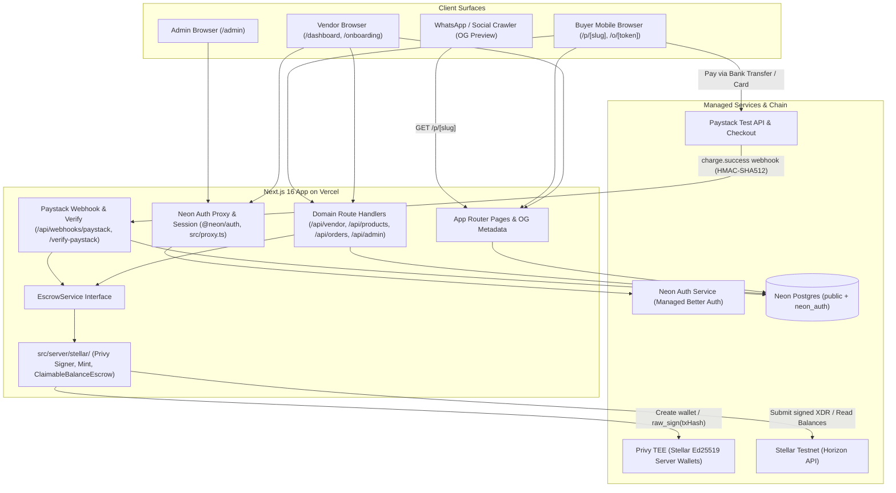
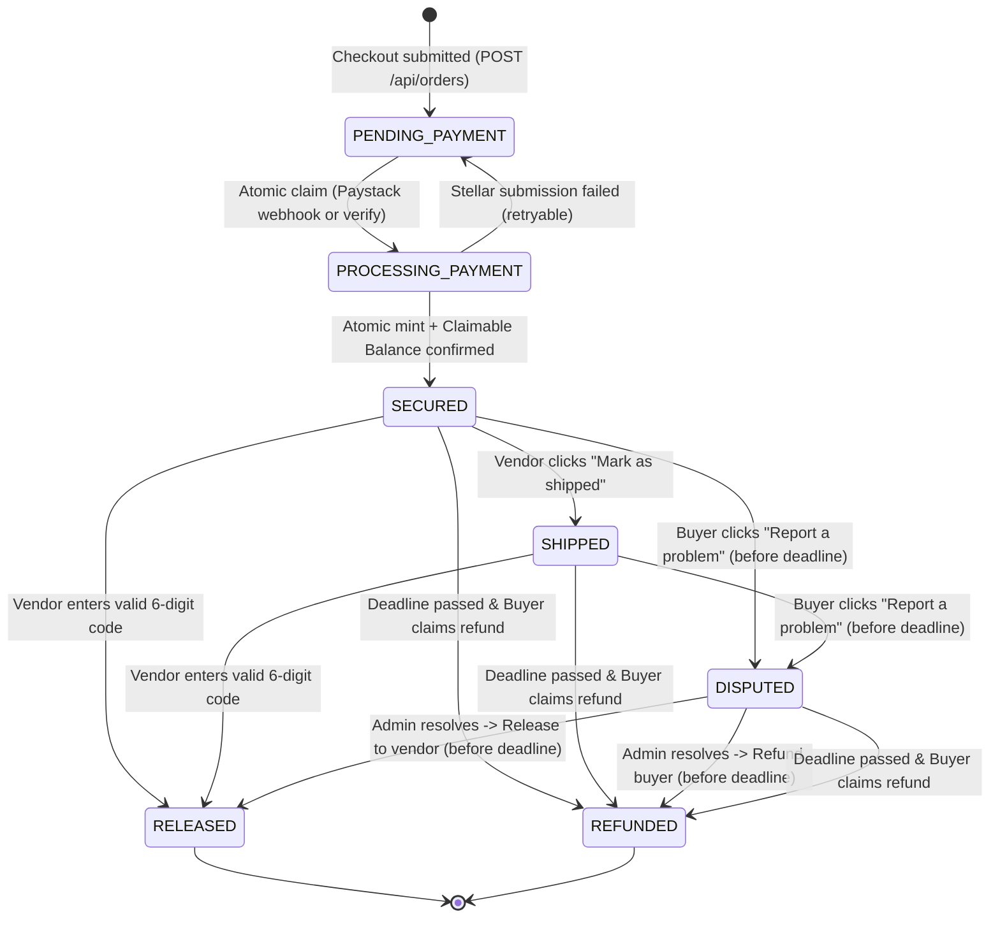

# Escrow Pay Links — System Design & Architecture

> **Status:** Implemented (Phases 0–6 Complete)  
> **Related Docs:** [`intent.md`](./intent.md) · [`plan.md`](./plan.md) · [`production-notes.md`](./production-notes.md) · [`.design/design-spec.md`](./.design/design-spec.md)  
> **Stack:** Next.js 16 (App Router) + Neon Postgres + Prisma 7 + **Neon Auth (Managed Better Auth)** + **Privy (Stellar Server Wallets)** + **Paystack (Test Mode)** + Stellar Testnet

---

## 1. Locked Architectural Decisions

| Area | Decision | Rationale |
| --- | --- | --- |
| **Auth** | **Neon Auth** (`@neon/auth/next/server` + `@neon/auth/next`) | Managed Better Auth living in Neon's `neon_auth` schema. Zero auth table boilerplate, automatic auth branching with DB branches, and `Vendor` business profile in `public`. |
| **Wallet Custody** | **Privy Test Tier** (`chain_type: "stellar"`, Tier 2 Ed25519 `raw_sign`) | Private keys for vendor and buyer Stellar accounts live inside Privy's TEE—**zero Stellar user/order private keys stored in Postgres**. Keeps the wallet layer production-shaped from Day 1. |
| **Naira Payment Rail** | **Paystack Test Mode** (`/transaction/initialize`, Bank Transfer + Card + USSD, `charge.success` webhook + verify callback) | Buyers get a real Nigerian Paystack checkout with test-mode Bank Transfer simulation. Dual idempotent verification (webhook + redirect verify) works seamlessly on both `localhost` and Vercel. |
| **Buyer Checkout UX** | Inline checkout on `/p/[slug]` with **required valid `buyerEmail`** + structured Nigerian address (`street`, `city`, `state`, optional `landmark`) | Zero signup/password while satisfying Paystack email validation, delivering payment receipts, and capturing courier-ready Nigerian addresses. |
| **Release Code UX** | Store **`codeHash`** (HMAC-SHA256) + **`codeEnc`** (AES-256-GCM) | Verifies vendor input securely (`timingSafeEqual`, locked at 5 attempts) while letting buyers reopen/refresh `/o/[token]` in WhatsApp's mobile browser without losing their 6-digit code. |
| **Escrow Funding Tx** | **Single atomic Stellar tx (`mintAndCreate`)** combining `ISSUER` mint + buyer `createClaimableBalance` | Cuts Horizon confirmation time from ~10s to ~5s (safe under Vercel Hobby's 10s limit) and prevents half-completed state. Separate `mintTestNgn()` and `escrow.create()` remain available for smoke scripts. |
| **Product Photos** | **Image URL** field + live `16:10` preview (`object-contain` on product cards) | Fastest path with zero external storage setup; see `production-notes.md` for Cloudflare R2 direct upload upgrade path. |
| **Disputes Past Deadline** | **Strict on-chain timer** (`ESCROW` valid only before `deadline`) | Preserves the trustless guarantee on Stellar. If a `DISPUTED` order passes its deadline unresolved, buyer can claim refund and `/admin` disables arbitration controls. |
| **Delivery Window Units** | Store **`windowMinutes`** on `Product` (`2` to `43200` minutes) | Supports presets (`2m` test, `24h`, `48h`, `72h`, `7d`) **and** custom seller-defined windows up to 30 days. |

---

## 2. Tech Stack

| Layer | Choice | Details |
| --- | --- | --- |
| **Framework** | Next.js 16 (App Router) + TypeScript | React Server Components for `/p/[slug]` (`generateMetadata()` OG tags for WhatsApp) and `/dashboard`; Route Handlers for APIs & webhooks; `src/proxy.ts` for route protection; `export const instant = false` on dynamic/auth routes (`cacheComponents: true`). |
| **Styling** | Tailwind CSS v4 | Warm Editorial Minimalism tokens (`Plus Jakarta Sans`, `Inter`, `JetBrains Mono`) optimized for mobile WhatsApp browsers and desktop dashboards. |
| **Database & ORM** | PostgreSQL (Neon) + Prisma 7 | `DATABASE_URL` (pooled `-pooler`, normalized to `sslmode=verify-full` via `@prisma/adapter-pg` in `src/lib/prisma.ts`) for runtime; `DATABASE_URL_UNPOOLED` via `prisma.config.ts` for `prisma migrate`. App tables live in `public`; Neon Auth manages `neon_auth`. |
| **Authentication** | **Neon Auth** (`@neon/auth`) | Managed Better Auth via `createNeonAuth()`, `auth.getSession()`, `auth.middleware()`, and custom Warm Editorial auth pages (`/login`, `/signup`). |
| **Wallets & Signing** | **Privy Server Wallets** (Privy REST API) | Creates Stellar Ed25519 wallets inside Privy's TEE and signs Stellar tx hashes via `raw_sign`. |
| **Payments** | **Paystack (Test Mode)** (`sk_test_...`) | Nigerian checkout (`bank_transfer`, `card`, `ussd`), signed `x-paystack-signature` (HMAC-SHA512) webhooks + `/transaction/verify/:reference`. |
| **Blockchain** | `@stellar/stellar-sdk` (Testnet) | Server-only under `src/server/stellar/`. Horizon REST API + Claimable Balances behind `EscrowService`. |
| **Validation** | `zod` | Strict runtime validation for API inputs and env variables. |
| **Hosting** | Vercel | Public HTTPS URL for WhatsApp OG crawlers, Paystack webhooks, and mobile testing. |

---

## 3. High-Level Architecture



---

## 4. Authentication & Vendor Onboarding (Neon Auth)

### 4.1 Setup
- **Server helper (`src/lib/auth/server.ts`):**
  ```ts
  import { createNeonAuth } from "@neon/auth/next/server";

  export const auth = createNeonAuth({
    baseUrl: process.env.NEON_AUTH_BASE_URL!,
    cookies: {
      secret: process.env.NEON_AUTH_COOKIE_SECRET!,
    },
  });
  ```
- **Client helper (`src/lib/auth/client.ts`):** Uses `@neon/auth/next` (`createAuthClient()`), wired to `src/app/api/auth/[...path]/route.ts`.
- **Auth Pages (`/signup`, `/login`):** Custom Warm Editorial email + password forms calling `authClient`.
- **Route Protection:**
  - `src/proxy.ts` (Next.js 16 proxy convention) protects `/dashboard/*`, `/onboarding`, and `/admin/*` using `auth.middleware()`.
  - Server Components & API routes verify the session with `await auth.getSession()`. Dynamic/auth pages declare `export const instant = false` for Next.js 16 `cacheComponents: true`.
  - `/admin` & `/api/admin/*` additionally check `session.user.email.toLowerCase() === process.env.ADMIN_EMAIL?.toLowerCase()`.

### 4.2 Vendor Profile & Wallet Provisioning (`/onboarding`)
Because Neon owns the `neon_auth` schema, vendor business details and Stellar wallet identifiers live in `public.Vendor` (keyed by `authUserId`):
1. New vendor signs up via Neon Auth → lands on `/dashboard`.
2. `/dashboard/layout.tsx` checks `prisma.vendor.findUnique({ where: { authUserId: session.user.id } })`.
3. If no `Vendor` record exists yet, redirects to `/onboarding`.
4. Vendor enters **Business Name** (required), **WhatsApp number** (optional), and **Instagram handle** (optional).
5. `POST /api/vendor/onboarding`:
   - Calls `createPrivyStellarAccount()` (creates Privy Stellar wallet + `TREASURY` funds it with `3 XLM` and adds `NGN` trustline in 1 Stellar transaction).
   - Inserts the `Vendor` row with `authUserId`, `email`, `businessName`, `whatsapp`, `instagram`, `stellarPublic`, and `privyWalletId`.
   - Redirects to `/dashboard` showing live `₦` balance from Horizon.

---

## 5. Stellar & Privy Wallet Sub-System (`src/server/stellar/`)

Everything Stellar and Privy lives strictly in `src/server/stellar/`. Client Components never import from it.

### 5.1 Platform Accounts (`scripts/bootstrap.ts`)
Created once via Testnet Friendbot with secrets stored in `.env.local` / Vercel:
- **`TREASURY`:** Pre-funded XLM account that pays minimum reserves (`3 XLM`) for each new vendor and buyer Stellar account.
- **`ISSUER`:** Issues the custom testnet asset `NGN` (`new Asset("NGN", ISSUER_PUBLIC)`).
- **`ESCROW`:** Holds an `NGN` trustline; claims balances before deadline for releases and admin dispute refunds.

### 5.2 Privy Stellar Server Wallets (Tier 2 `raw_sign`)
Vendor accounts (permanent, 1 per vendor) and Buyer accounts (ephemeral/one-use, 1 per order) are created as Privy Server Wallets:
1. **Create wallet:** `POST https://api.privy.io/v1/wallets` with `{ "chain_type": "stellar" }` → returns `{ id: privyWalletId, address: "G..." }`.
2. **Sign Stellar transaction (`signWithPrivy(tx, privyWalletId, publicKey)`):**
   - Compute 32-byte transaction hash: `const hashHex = "0x" + Buffer.from(tx.hash()).toString("hex")`.
   - Call Privy `raw_sign` on `privyWalletId` with `hashHex` → receives 64-byte Ed25519 signature.
   - Attach via `tx.addSignature(publicKey, signatureBytes.toString("base64"))` and submit `tx` to Horizon (base fee `1000` stroops).
3. **Provisioning (`createPrivyStellarAccount()`):**
   - Creates Privy Stellar wallet (`G...`).
   - Builds 1 atomic transaction sourced from `TREASURY`:
     1. `Operation.createAccount({ destination: newPub, startingBalance: "3" })`
     2. `Operation.changeTrust({ asset: NGN_ASSET, source: newPub })`
   - Signs with `TREASURY` keypair **and** `signWithPrivy(tx, privyWalletId, newPub)`, then submits to Horizon.
   - Reserve math: `1.0 XLM` base + `0.5 XLM` NGN trustline + `0.5 XLM` claimable balance reserve + `1.0 XLM` fee headroom = **`3.0 XLM`**.

### 5.3 `EscrowService` Interface & `ClaimableBalanceEscrow`

```ts
export interface EscrowService {
  create(params: {
    buyerPublicKey: string;
    buyerPrivyWalletId: string;
    amountNgn: string;
    deadlineUnix: number;
  }): Promise<{ claimableBalanceId: string; txHash: string }>;

  mintAndCreate(params: {
    buyerPublicKey: string;
    buyerPrivyWalletId: string;
    amountNgn: string;
    deadlineUnix: number;
  }): Promise<{ claimableBalanceId: string; txHash: string }>;

  release(params: {
    claimableBalanceId: string;
    vendorPublicKey: string;
    amountNgn: string;
  }): Promise<{ txHash: string }>;

  refund(params: {
    claimableBalanceId: string;
    buyerPublicKey: string;
    buyerPrivyWalletId: string;
  }): Promise<{ txHash: string }>;

  adminRefund(params: {
    claimableBalanceId: string;
    buyerPublicKey: string;
    amountNgn: string;
  }): Promise<{ txHash: string }>;

  status(claimableBalanceId: string): Promise<"OPEN" | "CLAIMED" | "UNKNOWN">;
}
```

**On-Chain Operations:**
- **Claimable Balance Predicates:**
  - Claimant 1: `ESCROW` with `Claimant.predicateBeforeAbsoluteTime(deadlineUnix.toString())`
  - Claimant 2: `buyerPublic` with `Claimant.predicateNot(Claimant.predicateBeforeAbsoluteTime(deadlineUnix.toString()))`
- **`mintAndCreate` (Paystack Confirmed Path):**
  Single atomic transaction (~5s ledger close), signed by `ISSUER` + `signWithPrivy(buyer)`:
  1. `Operation.payment({ source: ISSUER_PUBLIC, destination: buyerPublic, asset: NGN_ASSET, amount: amountNgn })`
  2. `Operation.createClaimableBalance({ source: buyerPublic, asset: NGN_ASSET, amount: amountNgn, claimants: [escrowClaimant, buyerClaimant] })`
- **`release`:** Single atomic tx signed by `ESCROW`: `claimClaimableBalance` → `payment` to `vendorPublicKey`.
- **`refund`:** Signed by `signWithPrivy(buyer)` after `deadlineUnix`: `claimClaimableBalance`.
- **`adminRefund` (before deadline):** Single atomic tx signed by `ESCROW`: `claimClaimableBalance` → `payment` to `buyerPublicKey`.
- **Expired Dispute Rule:** If `status == DISPUTED` and `now > deadline`, `/admin` displays *"Escrow window expired on-chain; buyer can claim refund directly"* and `/o/[token]` enables the buyer's **Claim full refund** button.

---

## 6. Paystack Test-Mode Payment Flow

1. **Order Creation (`POST /api/orders`):**
   - Validates `buyerName`, `buyerPhone`, valid `buyerEmail`, and structured Nigerian delivery address (`street`, `city`, `state`, optional `landmark`).
   - Provisions ephemeral buyer Privy Stellar wallet (`createPrivyStellarAccount()`).
   - Generates 6-digit release code → stores `codeHash` (HMAC-SHA256) + `codeEnc` (AES-256-GCM).
   - Calls Paystack `POST https://api.paystack.co/transaction/initialize` with:
     - `amount`: `Math.round(Number(product.priceNgn) * 100)` (in kobo)
     - `currency`: `"NGN"`
     - `email`: `buyerEmail`
     - `reference`: unique `paystackReference` (e.g., `epl_${orderId}`)
     - `channels`: `["bank_transfer", "card", "ussd"]`
     - `callback_url`: `${APP_URL}/o/${token}?verify=1`
     - `metadata`: `{ orderId, productId, slug }`
   - Saves `paystackReference` and `paystackAuthorizationUrl` on `Order` (`PENDING_PAYMENT`) and redirects buyer to `/o/[token]`.
2. **Buyer Payment Screen (`/o/[token]`):**
   - Renders a unified digital receipt sheet with order summary and a prominent **"Pay ₦X via Paystack"** CTA linking to `paystackAuthorizationUrl`.
3. **Dual Idempotent Confirmation (Webhook + Callback):**
   - **Path 1 — Webhook (`POST /api/webhooks/paystack`):** Verifies `x-paystack-signature` (HMAC-SHA512 using `PAYSTACK_SECRET_KEY`) against the raw request body. On `charge.success`, validates amount (`data.amount === expectedKobo`) and `currency === "NGN"`, then runs `confirmOrderPayment(orderId)`.
   - **Path 2 — Callback Verify (`POST /api/orders/[token]/verify-paystack`):** Triggered automatically when Paystack redirects back to `/o/[token]?verify=1` (makes local dev work without ngrok/CLI and eliminates webhook delay). Calls Paystack `GET /transaction/verify/:reference`, checks `status === "success"` and amount/currency match, then runs `confirmOrderPayment(orderId)`.
   - **Atomic Race Guard inside `confirmOrderPayment(orderId)` (`src/server/orders/confirm.ts`):**
     - Runs `prisma.order.updateMany({ where: { id: orderId, status: "PENDING_PAYMENT" }, data: { status: "PROCESSING_PAYMENT" } })`.
     - Only the winner (`count === 1`) executes `escrow.mintAndCreate(...)` on Stellar.
     - On success → updates `status: "SECURED"`, `claimableBalanceId`, `txCreate`, `deadline`.
     - On Stellar error → resets `status: "PENDING_PAYMENT"` so a retry/webhook redelivery can recover cleanly.

---

## 7. Prisma 7 Data Model & State Machine

Schema lives in [`prisma/schema.prisma`](./prisma/schema.prisma); migration connection string (`DATABASE_URL_UNPOOLED`) is configured in [`prisma.config.ts`](./prisma.config.ts).

```prisma
generator client {
  provider = "prisma-client"
  output   = "../src/generated/prisma"
}

datasource db {
  provider = "postgresql"
}

enum OrderStatus {
  PENDING_PAYMENT
  PROCESSING_PAYMENT
  SECURED
  SHIPPED
  RELEASED
  REFUNDED
  DISPUTED
}

model Vendor {
  id            String    @id @default(cuid())
  authUserId    String    @unique
  email         String    @unique
  businessName  String
  whatsapp      String?
  instagram     String?
  stellarPublic String    @unique
  privyWalletId String    @unique
  createdAt     DateTime  @default(now())
  updatedAt     DateTime  @updatedAt
  products      Product[]
}

model Product {
  id            String   @id @default(cuid())
  slug          String   @unique
  vendorId      String
  vendor        Vendor   @relation(fields: [vendorId], references: [id], onDelete: Cascade)
  name          String
  description   String?
  imageUrl      String?
  priceNgn      Decimal  @db.Decimal(12, 2)
  windowMinutes Int
  active        Boolean  @default(true)
  createdAt     DateTime @default(now())
  updatedAt     DateTime @updatedAt
  orders        Order[]

  @@index([vendorId])
}

model Order {
  id                       String      @id @default(cuid())
  token                    String      @unique
  productId                String
  product                  Product     @relation(fields: [productId], references: [id])

  buyerName                String
  buyerPhone               String
  buyerEmail               String?
  buyerAddress             String

  amountNgn                Decimal     @db.Decimal(12, 2)
  status                   OrderStatus @default(PENDING_PAYMENT)
  paystackReference        String?     @unique
  paystackAuthorizationUrl String?
  deadline                 DateTime?
  shippedAt                DateTime?
  disputeReason            String?
  disputedAt               DateTime?
  resolvedAt               DateTime?

  codeHash                 String
  codeEnc                  String
  releaseAttempts          Int         @default(0)

  buyerStellarPublic       String      @unique
  buyerPrivyWalletId       String      @unique
  claimableBalanceId       String?
  txCreate                 String?
  txRelease                String?
  txRefund                 String?

  createdAt                DateTime    @default(now())
  updatedAt                DateTime    @updatedAt

  @@index([productId])
  @@index([status])
}
```

### Order Lifecycle State Machine



---

## 8. Routes, APIs & Environment Variables

### Pages
| Route | Auth | Purpose |
| --- | --- | --- |
| `/` | Public | Editorial landing page with studio hero, interactive 3-beat `EscrowFlowDemo`, alternating bands, persistent header & footer |
| `/signup`, `/login` | Public | Neon Auth email + password signup/login |
| `/onboarding` | Neon Auth | Collect business name/WhatsApp/Instagram & provision vendor Privy Stellar wallet |
| `/p/[slug]` | Public | 2-column desktop / stacked mobile product showcase, seller completion rate, OG/Twitter preview tags, and inline zero-signup checkout form |
| `/o/[token]` | Capability URL | Unified digital receipt: Paystack launch, auto-verify on callback, decrypted release code + live countdown, dispute/refund, collapsed chain receipt |
| `/dashboard` | Vendor | Live Horizon NGN balance, DB-aggregated in-escrow total & order counts, recent orders, "Withdraw to bank" coming-soon modal |
| `/dashboard/products` & `/new` | Vendor | Paginated pay links (12/page), Copy link, Share to WhatsApp, new product form (image URL + presets & custom window) |
| `/dashboard/orders` & `/[id]` | Vendor | Server-paginated order queue (18/page, search `?q=`, status `?status=`), buyer shipping details, Mark shipped, segmented 6-digit release code entry, chain receipt |
| `/admin` | Admin | Paginated disputed orders queue (20/page) with equal-weight Refund Buyer / Release to Seller controls + deadline status |
| `not-found.tsx`, `error.tsx`, `loading.tsx` | All | Warm Editorial 404, error recovery boundary, and route-level loading skeletons (`/dashboard`, `/p/[slug]`, `/o/[token]`) |

### API Endpoints
- `GET/POST /api/auth/[...path]` *(Neon Auth proxy)*
- `POST /api/vendor/onboarding`
- `GET/POST /api/products` *(supports `?page=` & `?limit=`)*
- `PATCH /api/products/[id]` *(toggle active state)*
- `POST /api/orders`
- `POST /api/orders/[token]/verify-paystack` *(idempotent callback verification)*
- `POST /api/orders/[token]/refund`
- `POST /api/orders/[token]/dispute`
- `POST /api/webhooks/paystack` *(verifies `x-paystack-signature` HMAC-SHA512)*
- `POST /api/vendor/orders/[id]/ship` *(namespaced under `/api/vendor/` to avoid `[token]` vs `[id]` sibling route conflict)*
- `POST /api/vendor/orders/[id]/release`
- `POST /api/admin/orders/[id]/resolve`

### Environment Variables (`.env.example`)
```env
# App URL (used for Paystack callbacks & OG links)
NEXT_PUBLIC_APP_URL="http://localhost:3000"

# Database (Neon Postgres)
# Runtime uses pooled DATABASE_URL; Prisma migrations use unpooled DATABASE_URL_UNPOOLED
DATABASE_URL="postgresql://...-pooler.../neondb?sslmode=require"
DATABASE_URL_UNPOOLED="postgresql://.../neondb?sslmode=require"

# Neon Auth (Managed Better Auth)
NEON_AUTH_BASE_URL="https://<your-neon-auth-url>.neon.tech/neondb/auth"
NEON_AUTH_COOKIE_SECRET="<32+ char random secret>"
NEON_AUTH_JWKS_URL="https://<your-neon-auth-url>.neon.tech/neondb/auth/.well-known/jwks.json"

# Privy (Stellar Test Server Wallets)
PRIVY_APP_ID="<privy-app-id>"
PRIVY_APP_SECRET="<privy-app-secret>"

# Paystack (Test Mode)
PAYSTACK_SECRET_KEY="sk_test_..."
NEXT_PUBLIC_PAYSTACK_PUBLIC_KEY="pk_test_..."

# Release Code Encryption & HMAC (AES-256-GCM, 64 hex chars / 32 bytes)
ENCRYPTION_KEY="<64-char hex (32 bytes)>"

# Stellar Testnet Platform Accounts (from scripts/bootstrap.ts)
TREASURY_SECRET="S..."
ISSUER_SECRET="S..."
ESCROW_SECRET="S..."

# Admin Arbitration Access
ADMIN_EMAIL="admin@example.com"
```

---

## 9. Security & Reliability Guardrails

1. **No User Private Keys in Postgres:** Vendor and buyer Stellar private keys live strictly inside Privy's TEE; our DB only stores `stellarPublic` and `privyWalletId`.
2. **Verified Paystack Events Only:** `/api/webhooks/paystack` verifies `x-paystack-signature` using `crypto.timingSafeEqual` against the raw request body, and both webhook + callback verify exact `amount` (in kobo) and `currency === "NGN"` before minting/escrowing.
3. **Race-Safe Idempotency:** `PENDING_PAYMENT -> PROCESSING_PAYMENT` atomic conditional update prevents simultaneous Paystack webhook + redirect callback from double-minting or creating duplicate Claimable Balances.
4. **Release Code Protection:** Verified with `HMAC-SHA256` + `crypto.timingSafeEqual`, locked after 5 failed vendor attempts (`releaseAttempts >= 5`), while `codeEnc` lets the buyer reliably view their code across mobile browser reloads.
5. **Clean Production Path:** Swapping from test to live requires switching Paystack keys, adding a licensed NGN/cNGN Stellar anchor or pre-funded float for real on-ramp/off-ramp (see [`production-notes.md`](./production-notes.md)), and optionally replacing `ClaimableBalanceEscrow` with a Soroban contract behind `EscrowService`.
