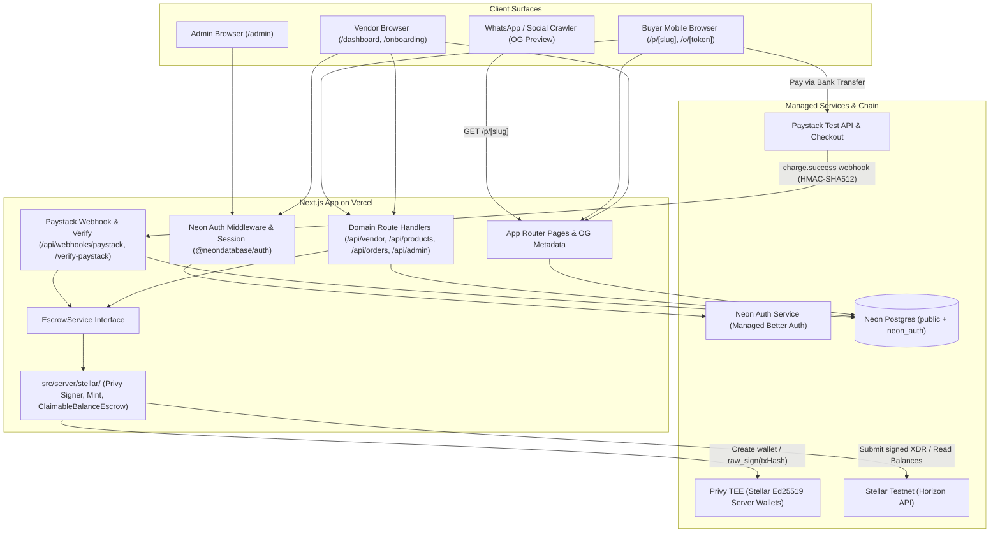
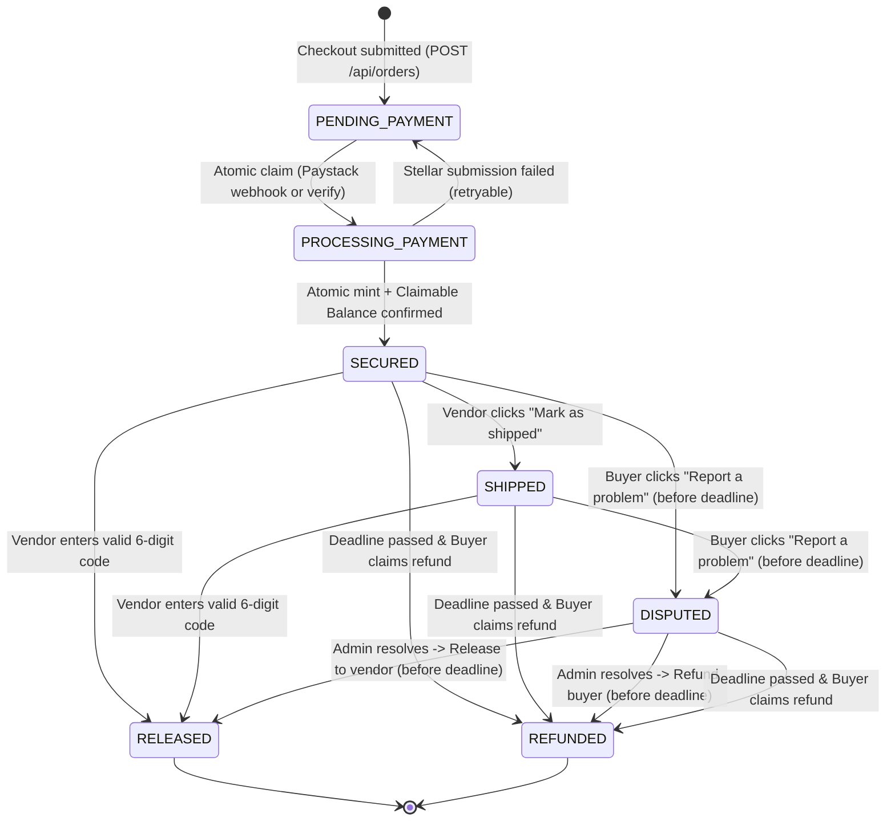

# Escrow Pay Links — System Design & Architecture

> **Status:** Architecture Locked (Ready for Implementation)  
> **Source Plan:** [`plan.md`](./plan.md)  
> **Stack:** Next.js (App Router) + Neon Postgres + **Neon Auth (Managed Better Auth)** + **Privy (Stellar Server Wallets)** + **Paystack (Test Mode)** + Stellar Testnet

---

## 1. Locked Architectural Decisions

| Area | Decision | Rationale |
| --- | --- | --- |
| **Auth** | **Neon Auth** (`@neondatabase/auth` + `@neondatabase/auth-ui`) | Managed Better Auth living in Neon's `neon_auth` schema. Zero auth table boilerplate, automatic auth branching with DB branches, built-in UI components, and `Vendor` business profile in `public`. |
| **Wallet Custody** | **Privy Test Tier** (`chain_type: "stellar"`, Tier 2 Ed25519 `raw_sign`) | Private keys for vendor and buyer Stellar accounts live inside Privy's TEE—**zero Stellar user/order private keys stored in Postgres**. Keeps the wallet layer production-shaped from Day 1. |
| **Naira Payment Rail** | **Paystack Test Mode** (`/transaction/initialize`, Bank Transfer + Card, `charge.success` webhook + verify callback) | Buyers get a real Nigerian Paystack checkout with test-mode Bank Transfer simulation instead of a fake transfer screen. Dual idempotent verification (webhook + redirect verify) works seamlessly on both `localhost` and Vercel. |
| **Release Code UX (1A)** | Store **`codeHash`** (HMAC-SHA256) + **`codeEnc`** (AES-256-GCM) | Verifies vendor input securely while letting buyers reopen/refresh `/o/[token]` in WhatsApp's mobile browser without losing their 6-digit code. |
| **Escrow Funding Tx (2A)** | **Single atomic Stellar tx (`mintAndCreate`)** combining `ISSUER` mint + buyer `createClaimableBalance` | Cuts Horizon confirmation time from ~10s to ~5s (safe under Vercel Hobby's 10s limit) and prevents half-completed state. Separate `mintTestNgn()` and `escrow.create()` remain available for smoke scripts. |
| **Product Photos (3A)** | **Image URL** field | Fastest Day 1 path with zero external storage setup; easily upgraded to Vercel Blob later. |
| **Disputes Past Deadline (4A)** | **Strict on-chain timer** (`ESCROW` valid only before `deadline`) | Preserves the trustless guarantee on Stellar. If a `DISPUTED` order passes its deadline unresolved, buyer can claim refund and `/admin` shows "Deadline expired." |
| **Delivery Window Units** | Store **`windowMinutes`** (not `windowHours`) on `Product` | Supports standard presets (24h = 1440, 48h = 2880, 72h = 4320, 7d = 10080) **and** the **2-minute** test window required by `plan.md`'s acceptance test. |

---

## 2. Tech Stack

| Layer | Choice | Details |
| --- | --- | --- |
| **Framework** | Next.js (App Router) + TypeScript | React Server Components for `/p/[slug]` (`generateMetadata()` OG tags for WhatsApp) and `/dashboard`; Route Handlers for APIs & webhooks. |
| **Styling** | Tailwind CSS | Mobile-first UI optimized for buyers opening links inside WhatsApp on phones. |
| **Database & ORM** | PostgreSQL (Neon) + Prisma | `DATABASE_URL` (pooled `-pooler`) for runtime + `DIRECT_URL` (unpooled) for `prisma migrate`. App tables live in `public`; Neon Auth manages `neon_auth`. |
| **Authentication** | **Neon Auth** (`@neondatabase/auth`, `@neondatabase/auth-ui`) | Managed Better Auth via `createNeonAuth()`, `auth.getSession()`, `auth.middleware()`, and drop-in auth UI. |
| **Wallets & Signing** | **Privy Server Wallets** (`@privy-io/node` or Privy REST API) | Creates Stellar Ed25519 wallets inside Privy's TEE and signs Stellar tx hashes via `raw_sign`. |
| **Payments** | **Paystack (Test Mode)** (`sk_test_...`) | Real Nigerian checkout flow (`channel: "bank_transfer"` + card/USSD), signed `x-paystack-signature` (HMAC-SHA512) webhooks + `/transaction/verify/:reference`. |
| **Blockchain** | `@stellar/stellar-sdk` (Testnet) | Server-only under `src/server/stellar/`. Horizon REST API + Claimable Balances behind `EscrowService`. |
| **Validation** | `zod` | Strict runtime validation for API inputs and env variables. |
| **Hosting** | Vercel | Public HTTPS URL for WhatsApp OG crawlers, Paystack webhooks, and mobile testing. |

---

## 3. High-Level Architecture



---

## 4. Authentication & Vendor Onboarding (Neon Auth)

### 4.1 Setup
- Enable **Auth** in the Neon Console to provision the managed `neon_auth` schema and `NEON_AUTH_BASE_URL`.
- **Server helper (`src/lib/auth/server.ts`):**
  ```ts
  import { createNeonAuth } from "@neondatabase/auth/next/server";

  export const auth = createNeonAuth({
    baseUrl: process.env.NEON_AUTH_BASE_URL!,
    cookies: {
      secret: process.env.NEON_AUTH_COOKIE_SECRET!,
    },
  });
  ```
- **Auth Pages (`/signup`, `/login`):** Rendered using `@neondatabase/auth-ui` (or Neon Auth client hooks) with Email + Password enabled.
- **Route Protection:**
  - `src/middleware.ts` protects `/dashboard/*`, `/onboarding`, and `/admin/*` using `auth.middleware()`.
  - Server Components & API routes verify the session with `await auth.getSession()`.
  - `/admin` & `/api/admin/*` additionally check `session.user.email.toLowerCase() === process.env.ADMIN_EMAIL?.toLowerCase()`.

### 4.2 Vendor Profile & Wallet Provisioning (`/onboarding`)
Because Neon owns the `neon_auth` schema, vendor business details and Stellar wallet identifiers live in our `public.Vendor` Prisma table (keyed by `authUserId`):
1. New vendor signs up via Neon Auth → lands on `/dashboard`.
2. `/dashboard/layout.tsx` checks `prisma.vendor.findUnique({ where: { authUserId: session.user.id } })`.
3. If no `Vendor` record exists yet, redirect to `/onboarding`.
4. Vendor enters **Business Name** (required), **WhatsApp number** (optional), and **Instagram handle** (optional).
5. `POST /api/vendor/onboarding`:
   - Calls `createPrivyStellarAccount()` (creates Privy Stellar wallet + `TREASURY` funds it with `3 XLM` and adds `NGN` trustline in 1 Stellar transaction).
   - Inserts the `Vendor` row with `authUserId`, `email`, `businessName`, `whatsapp`, `instagram`, `stellarPublic`, and `privyWalletId`.
   - Redirects to `/dashboard` showing `₦0` NGN balance from Horizon.

---

## 5. Stellar & Privy Wallet Sub-System (`src/server/stellar/`)

Everything Stellar and Privy lives strictly in `src/server/stellar/`. UI components never import from it.

### 5.1 Platform Accounts (`scripts/bootstrap.ts`)
Created once via Testnet Friendbot with secrets stored in `.env` / Vercel:
- **`TREASURY`:** Pre-funded XLM account that pays minimum reserves (`3 XLM`) for each new vendor and buyer Stellar account.
- **`ISSUER`:** Issues the custom testnet asset `NGN` (`new Asset("NGN", ISSUER_PUBLIC)`).
- **`ESCROW`:** Holds an `NGN` trustline; claims balances before deadline for releases and admin dispute refunds.

### 5.2 Privy Stellar Server Wallets (Tier 2 `raw_sign`)
Vendor accounts (permanent, 1 per vendor) and Buyer accounts (ephemeral/one-use, 1 per order) are created as Privy Server Wallets:
1. **Create wallet:** `POST https://api.privy.io/v1/wallets` with `{ "chain_type": "stellar" }` → returns `{ id: privyWalletId, address: "G..." }`.
2. **Sign Stellar transaction (`signWithPrivy(tx, privyWalletId, publicKey)`):**
   - Compute 32-byte transaction hash: `const hashHex = "0x" + tx.hash().toString("hex")`.
   - Call Privy `raw_sign` on `privyWalletId` with `hashHex` → receives 64-byte Ed25519 signature.
   - Construct `xdr.DecoratedSignature({ hint: Keypair.fromPublicKey(publicKey).signatureHint(), signature: Buffer.from(sigHex, "hex") })`.
   - Attach to `tx.signatures.push(decoratedSig)` and submit `tx` to Horizon.
3. **Provisioning (`createPrivyStellarAccount()`):**
   - Creates Privy Stellar wallet (`G...`).
   - Builds 1 atomic transaction sourced from `TREASURY`:
     1. `Operation.createAccount({ destination: newPub, startingBalance: "3" })`
     2. `Operation.changeTrust({ asset: NGN_ASSET, source: newPub })`
   - Signs with `TREASURY` keypair **and** `signWithPrivy(tx, privyWalletId, newPub)`, then submits to Horizon.
   - Reserve math: `1.0 XLM` base + `0.5 XLM` NGN trustline + `0.5 XLM` claimable balance reserve + `1.0 XLM` fee headroom = **`3.0 XLM`**.

### 5.3 `EscrowService` Interface & `ClaimableBalanceEscrow`

```ts
export interface EscrowService {
  create(params: {
    buyerPublicKey: string;
    buyerPrivyWalletId: string;
    amountNgn: string;
    deadlineUnix: number;
  }): Promise<{ claimableBalanceId: string; txHash: string }>;

  mintAndCreate(params: {
    buyerPublicKey: string;
    buyerPrivyWalletId: string;
    amountNgn: string;
    deadlineUnix: number;
  }): Promise<{ claimableBalanceId: string; txHash: string }>;

  release(params: {
    claimableBalanceId: string;
    vendorPublicKey: string;
    amountNgn: string;
  }): Promise<{ txHash: string }>;

  refund(params: {
    claimableBalanceId: string;
    buyerPublicKey: string;
    buyerPrivyWalletId: string;
  }): Promise<{ txHash: string }>;

  adminRefund(params: {
    claimableBalanceId: string;
    buyerPublicKey: string;
    amountNgn: string;
  }): Promise<{ txHash: string }>;

  status(claimableBalanceId: string): Promise<"OPEN" | "CLAIMED" | "UNKNOWN">;
}
```

**On-Chain Operations:**
- **Claimable Balance Predicates (Decision 4A):**
  - Claimant 1: `ESCROW` with `Claimant.predicateBeforeAbsoluteTime(deadlineUnix.toString())`
  - Claimant 2: `buyerPublic` with `Claimant.predicateNot(Claimant.predicateBeforeAbsoluteTime(deadlineUnix.toString()))`
- **`mintAndCreate` (Paystack Confirmed Path — Decision 2A):**
  Single atomic transaction (~5s ledger close), signed by `ISSUER` + `signWithPrivy(buyer)`:
  1. `Operation.payment({ source: ISSUER_PUBLIC, destination: buyerPublic, asset: NGN_ASSET, amount: amountNgn })`
  2. `Operation.createClaimableBalance({ source: buyerPublic, asset: NGN_ASSET, amount: amountNgn, claimants: [escrowClaimant, buyerClaimant] })`
- **`release`:** Single atomic tx signed by `ESCROW`: `claimClaimableBalance` → `payment` to `vendorPublicKey`.
- **`refund`:** Signed by `signWithPrivy(buyer)` after `deadlineUnix`: `claimClaimableBalance`.
- **`adminRefund` (before deadline):** Single atomic tx signed by `ESCROW`: `claimClaimableBalance` → `payment` to `buyerPublicKey`.
- **Expired Dispute Rule (Decision 4A):** If `status == DISPUTED` and `now > deadline`, `/admin` displays *"Deadline expired — buyer refund active"* and `/o/[token]` enables the buyer's **Claim refund** button.

---

## 6. Paystack Test-Mode Payment Flow

1. **Order Creation (`POST /api/orders`):**
   - Provisions ephemeral buyer Privy Stellar wallet (`createPrivyStellarAccount()`).
   - Generates 6-digit release code → stores `codeHash` (HMAC-SHA256) + `codeEnc` (AES-256-GCM).
   - Calls Paystack `POST https://api.paystack.co/transaction/initialize` with:
     - `amount`: `Math.round(Number(product.priceNgn) * 100)` (in kobo)
     - `currency`: `"NGN"`
     - `email`: `buyerEmail || \`order-${orderId}@checkout.escrowpay.test\`` *(Paystack requires an email even when optional in our UI)*
     - `reference`: unique `paystackReference` (e.g., `epl_${orderId}`)
     - `channels`: `["bank_transfer", "card", "ussd"]`
     - `callback_url`: `${APP_URL}/o/${token}?verify=1`
     - `metadata`: `{ orderId, productId, slug }`
   - Saves `paystackReference` and `paystackAuthorizationUrl` on `Order` (`PENDING_PAYMENT`) and redirects buyer to `/o/[token]`.
2. **Buyer Payment Screen (`/o/[token]`):**
   - Shows order summary, *"TEST MODE — Paystack Sandbox"* badge, and a prominent **"Pay ₦X via Paystack"** button linking to `paystackAuthorizationUrl` (where buyer selects **Bank Transfer** → **Simulate Success**).
3. **Dual Idempotent Confirmation (Webhook + Callback):**
   - **Path 1 — Webhook (`POST /api/webhooks/paystack`):** Verifies `x-paystack-signature` (HMAC-SHA512 using `PAYSTACK_SECRET_KEY`) against the raw request body. On `charge.success`, validates amount (`data.amount === expectedKobo`) and runs `confirmOrderPayment(orderId)`.
   - **Path 2 — Callback Verify (`POST /api/orders/[token]/verify-paystack`):** Triggered automatically when Paystack redirects back to `/o/[token]?verify=1` (makes local dev work without ngrok/CLI and eliminates webhook delay on the UX). Calls Paystack `GET /transaction/verify/:reference`, checks `status === "success"` and amount match, then runs the exact same `confirmOrderPayment(orderId)`.
   - **Atomic Race Guard inside `confirmOrderPayment(orderId)`:**
     - Runs `prisma.order.updateMany({ where: { id: orderId, status: "PENDING_PAYMENT" }, data: { status: "PROCESSING_PAYMENT" } })`.
     - Only the winner (`count === 1`) executes `escrow.mintAndCreate(...)` on Stellar.
     - On success → updates `status: "SECURED"`, `claimableBalanceId`, `txCreate`, `deadline`.
     - On Stellar error → resets `status: "PENDING_PAYMENT"` so a retry/webhook redelivery can recover cleanly.

---

## 7. Audited Prisma Data Model & State Machine

```prisma
generator client {
  provider = "prisma-client-js"
}

datasource db {
  provider  = "postgresql"
  url       = env("DATABASE_URL")
  directUrl = env("DIRECT_URL")
}

enum OrderStatus {
  PENDING_PAYMENT
  PROCESSING_PAYMENT
  SECURED
  SHIPPED
  RELEASED
  REFUNDED
  DISPUTED
}

// ─── Vendor Profile (linked to Neon Auth user in neon_auth schema) ──────────

model Vendor {
  id            String    @id @default(cuid())
  authUserId    String    @unique // References neon_auth.user.id
  email         String    @unique
  businessName  String
  whatsapp      String?
  instagram     String?
  stellarPublic String    @unique
  privyWalletId String    @unique
  createdAt     DateTime  @default(now())
  updatedAt     DateTime  @updatedAt
  products      Product[]
}

// ─── Products & Shareable Links ──────────────────────────────────────────────

model Product {
  id            String   @id @default(cuid())
  slug          String   @unique // 6-8 char slug for /p/[slug]
  vendorId      String
  vendor        Vendor   @relation(fields: [vendorId], references: [id], onDelete: Cascade)
  name          String
  description   String?
  imageUrl      String?  // Image URL (Decision 3A)
  priceNgn      Decimal  @db.Decimal(12, 2)
  windowMinutes Int      // e.g. 2 (test), 1440 (24h), 2880 (48h), 4320 (72h), 10080 (7d)
  active        Boolean  @default(true)
  createdAt     DateTime @default(now())
  updatedAt     DateTime @updatedAt
  orders        Order[]

  @@index([vendorId])
}

// ─── Orders & Escrow State ───────────────────────────────────────────────────

model Order {
  id                       String      @id @default(cuid())
  token                    String      @unique // unguessable 32-char token for /o/[token]
  productId                String
  product                  Product     @relation(fields: [productId], references: [id])

  // Buyer checkout details
  buyerName                String
  buyerPhone               String
  buyerEmail               String?
  buyerAddress             String

  // Payment & lifecycle
  amountNgn                Decimal     @db.Decimal(12, 2)
  status                   OrderStatus @default(PENDING_PAYMENT)
  paystackReference        String?     @unique
  paystackAuthorizationUrl String?
  deadline                 DateTime?
  shippedAt                DateTime?
  disputeReason            String?
  disputedAt               DateTime?
  resolvedAt               DateTime?

  // Release code (Decision 1A)
  codeHash                 String      // HMAC-SHA256 for vendor verification
  codeEnc                  String      // AES-256-GCM so buyer sees code on refresh at /o/[token]
  releaseAttempts          Int         @default(0) // Lock at 5 wrong attempts

  // Ephemeral buyer Privy Stellar wallet & on-chain receipts
  buyerStellarPublic       String      @unique
  buyerPrivyWalletId       String      @unique
  claimableBalanceId       String?
  txCreate                 String?
  txRelease                String?
  txRefund                 String?

  createdAt                DateTime    @default(now())
  updatedAt                DateTime    @updatedAt

  @@index([productId])
  @@index([status])
}
```

### Order Lifecycle State Machine



---

## 8. Routes, APIs & Environment Variables

### Pages
| Route | Auth | Purpose |
| --- | --- | --- |
| `/`, `/signup`, `/login` | Public | Landing + Neon Auth signup/login |
| `/onboarding` | Neon Auth | Collect business name/WhatsApp/Instagram & provision vendor Privy Stellar wallet |
| `/p/[slug]` | Public | Mobile-first product card, seller completion rate, OG/Twitter preview tags |
| `/p/[slug]/checkout` | Public | Guest buyer checkout form (name, phone, optional email, address) |
| `/o/[token]` | Capability URL | Paystack test checkout launch, auto-verify on callback, decrypted release code + countdown, dispute/refund, chain receipt |
| `/dashboard` | Vendor | Horizon NGN balance, in-escrow total, order counts, "Withdraw to bank" placeholder modal |
| `/dashboard/products` & `/new` | Vendor | Product list, Copy link, Share to WhatsApp, new product form (image URL + window presets incl. 2-min test) |
| `/dashboard/orders` & `/[id]` | Vendor | Order table, buyer shipping details, Mark shipped, Enter release code, chain receipt |
| `/admin` | Admin | Disputed orders list with Release / Refund controls + deadline status |

### API Endpoints
- `POST /api/vendor/onboarding`
- `GET/POST /api/products`
- `POST /api/orders`
- `POST /api/orders/[token]/verify-paystack` *(idempotent callback verification)*
- `POST /api/webhooks/paystack` *(verifies `x-paystack-signature` HMAC-SHA512)*
- `POST /api/orders/[id]/ship`
- `POST /api/orders/[id]/release`
- `POST /api/orders/[token]/refund`
- `POST /api/orders/[token]/dispute`
- `POST /api/admin/orders/[id]/resolve`

### Environment Variables (`.env.example`)
```env
# App URL (used for Paystack callbacks & OG links)
NEXT_PUBLIC_APP_URL="http://localhost:3000"

# Database (Neon Postgres)
DATABASE_URL="postgresql://...-pooler.../neondb?sslmode=require"
DIRECT_URL="postgresql://.../neondb?sslmode=require"

# Neon Auth (Managed Better Auth)
NEON_AUTH_BASE_URL="https://<your-neon-auth-url>.neon.tech/neondb/auth"
NEON_AUTH_COOKIE_SECRET="<32+ char random secret>"

# Privy (Stellar Test Server Wallets)
PRIVY_APP_ID="<privy-app-id>"
PRIVY_APP_SECRET="<privy-app-secret>"

# Paystack (Test Mode)
PAYSTACK_SECRET_KEY="sk_test_..."
NEXT_PUBLIC_PAYSTACK_PUBLIC_KEY="pk_test_..."

# Release Code Encryption & HMAC (AES-256-GCM)
ENCRYPTION_KEY="<64-char hex (32 bytes)>"

# Stellar Testnet Platform Accounts (from scripts/bootstrap.ts)
TREASURY_SECRET="S..."
ISSUER_SECRET="S..."
ESCROW_SECRET="S..."

# Admin Arbitration Access
ADMIN_EMAIL="admin@example.com"
```

---

## 9. Security & Reliability Guardrails

1. **No User Private Keys in Postgres:** Vendor and buyer Stellar private keys live strictly inside Privy's TEE; our DB only stores `stellarPublic` and `privyWalletId`.
2. **Verified Paystack Events Only:** `/api/webhooks/paystack` verifies `x-paystack-signature` using `crypto.timingSafeEqual` against the raw request body, and both webhook + callback verify exact `amount` (in kobo) and `currency === "NGN"` before minting/escrowing.
3. **Race-Safe Idempotency:** `PENDING_PAYMENT -> PROCESSING_PAYMENT` atomic conditional update prevents simultaneous Paystack webhook + redirect callback from double-minting or creating duplicate Claimable Balances.
4. **Release Code Protection:** Verified with `HMAC-SHA256` + `crypto.timingSafeEqual`, locked after 5 failed vendor attempts (`releaseAttempts >= 5`), while `codeEnc` lets the buyer reliably view their code across mobile browser reloads.
5. **Clean Production Path:** In production, swapping from test to live only requires switching Paystack keys + adding a licensed NGN/USDC Stellar anchor for real on-ramp/off-ramp (replacing `ISSUER` minting and the Withdraw modal), and optionally replacing `ClaimableBalanceEscrow` with a Soroban contract behind `EscrowService`.
